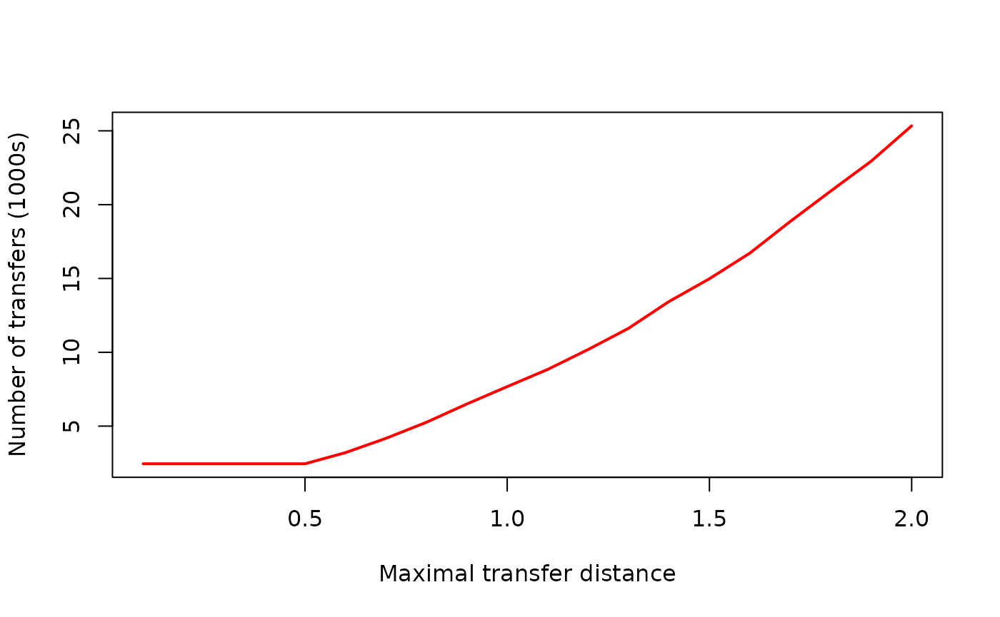
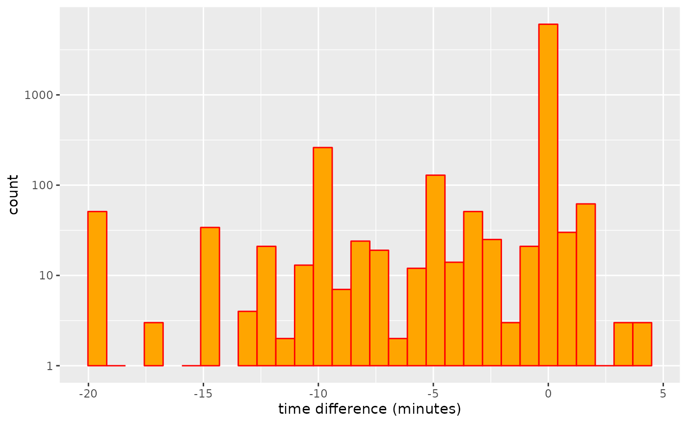
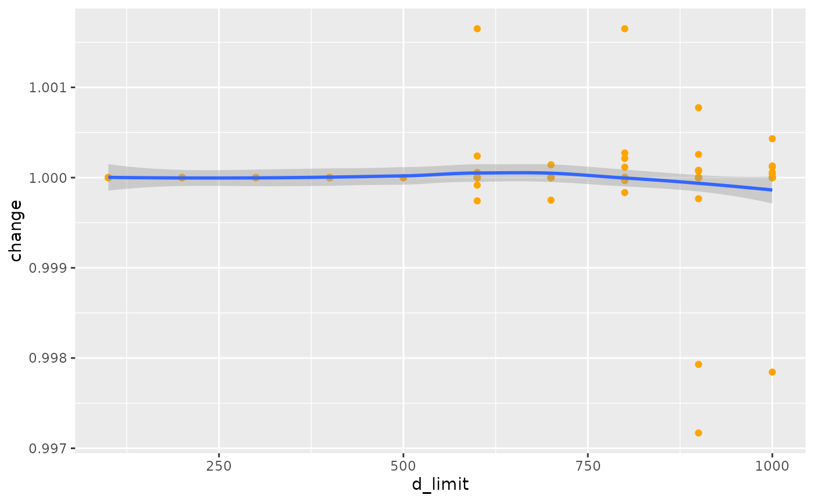
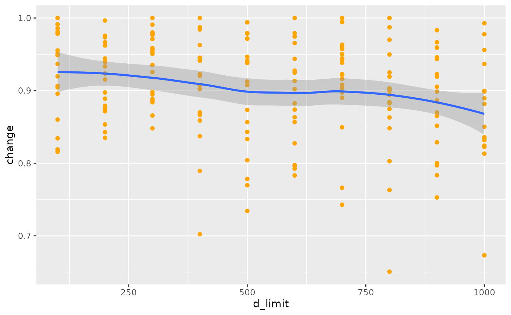
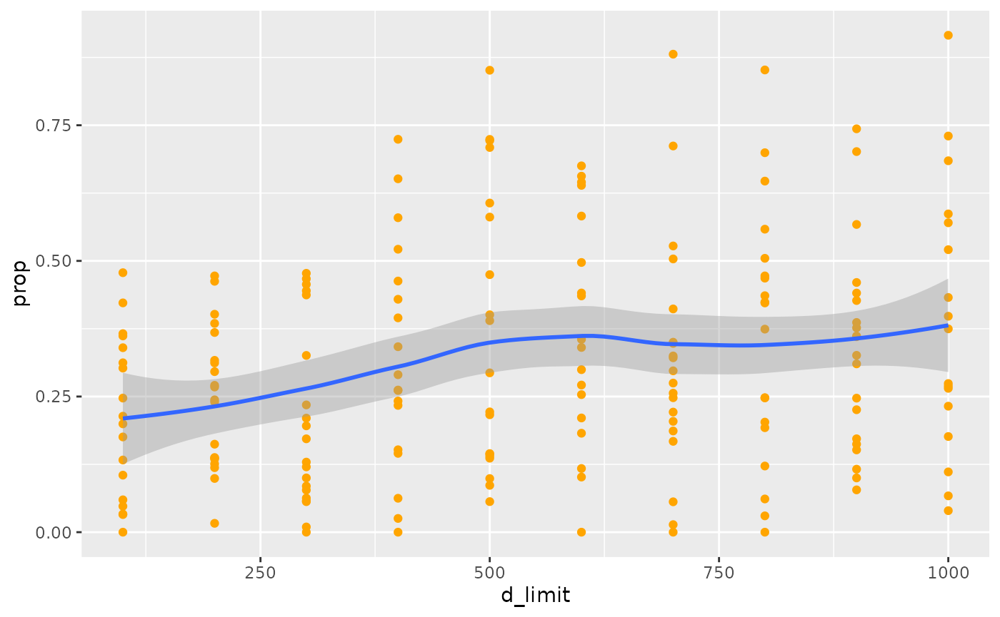

# Transfer Tables

GTFS feeds may include a table of possible transfers between stops, and
potentially between specific connecting services. There feeds are
nevertheless optional, and many feeds omit transfer tables, making them
difficult if not impossible to use for routing. The `gtfsrouter` package
includes a function,
[`gtfs_transfer_table()`](https://UrbanAnalyst.github.io/gtfsrouter/reference/gtfs_transfer_table.html),
which calculates and inserts a transfer table into a feed.

## Basic Usage

This function can also be demonstrated with the very small feed included
with this package, by first running
[`berlin_gtfs_to_zip()`](https://UrbanAnalyst.github.io/gtfsrouter/reference/berlin_gtfs_to_zip.html)
to create the feed in the temporary directory of the current R session.

``` r

library (gtfsrouter)
f <- berlin_gtfs_to_zip ()
gtfs <- extract_gtfs (f, quiet = TRUE)
```

The transfers table of the feed looks like this:

``` r

gtfs$transfers
```

    ##       from_stop_id   to_stop_id transfer_type min_transfer_time from_route_id
    ##             <char>       <char>         <int>             <num>        <char>
    ##    1: 000008010205 000008010205             2               300              
    ##    2: 000008010205 000008098205             2               300              
    ##    3: 000008010318 000008010318             2               300              
    ##    4: 000008011460 000008011460             2               300              
    ##    5: 000008012656 000008012656             2               300              
    ##   ---                                                                        
    ## 9829: 070101051881 070201024602             2               180              
    ## 9830: 070101051881 070101051881             2               120              
    ## 9831: 060230000099 060230000841             2               300              
    ## 9832: 060230000099 060230000842             2               300              
    ## 9833: 060230000099 060230000099             2               180              
    ##       to_route_id from_trip_id to_trip_id
    ##            <char>        <int>      <int>
    ##    1:                       NA         NA
    ##    2:                       NA         NA
    ##    3:                       NA         NA
    ##    4:                       NA         NA
    ##    5:                       NA         NA
    ##   ---                                    
    ## 9829:                       NA         NA
    ## 9830:                       NA         NA
    ## 9831:                       NA         NA
    ## 9832:                       NA         NA
    ## 9833:                       NA         NA

A transfers table is required for successful routing between different
services, like with the following code:

``` r

gtfs_route (
    gtfs,
    from = "Friedrichstr.",
    to = "Rosenthaler Platz",
    start_time = 12 * 3600,
    day = "Monday"
)
```

    ##   route_name       trip_name                      stop_name arrival_time
    ## 1         S1       S Frohnau S+U Friedrichstr. Bhf (Berlin)     12:00:06
    ## 2         S1       S Frohnau  S Oranienburger Str. (Berlin)     12:02:12
    ## 3         S1       S Frohnau         S Nordbahnhof (Berlin)     12:04:12
    ## 4         S1       S Frohnau        S Humboldthain (Berlin)     12:06:54
    ## 5         S1       S Frohnau S+U Gesundbrunnen Bhf (Berlin)     12:08:42
    ## 6         U8 S+U Hermannstr. S+U Gesundbrunnen Bhf (Berlin)     12:15:30
    ## 7         U8 S+U Hermannstr.           U Voltastr. (Berlin)     12:17:00
    ## 8         U8 S+U Hermannstr.       U Bernauer Str. (Berlin)     12:18:30
    ## 9         U8 S+U Hermannstr.   U Rosenthaler Platz (Berlin)     12:20:00
    ##   departure_time
    ## 1       12:00:54
    ## 2       12:02:42
    ## 3       12:04:42
    ## 4       12:07:24
    ## 5       12:09:24
    ## 6       12:15:30
    ## 7       12:17:00
    ## 8       12:18:30
    ## 9       12:20:00

That trip requires a transfer, and is possible because the feed has a
table specifying the possibility of transferring at the “S+U
Gesundbrunnen Bhf” station. Removing the transfers table demonstrates
what typically happens when attempting to calculate routes on feeds
which lack this information:

``` r

gtfs$transfers <- NULL
gtfs_route (
    gtfs,
    from = "Friedrichstr.",
    to = "Rosenthaler Platz",
    start_time = 12 * 3600,
    day = "Monday"
)
```

    ## NULL

No transfer is able to be make, and so no route is found. [The
`gtfs_transfer_table()`
function](https://UrbanAnalyst.github.io/gtfsrouter/reference/gtfs_transfer_table.html)
automatically calculates and adds a transfer table to a feed, enabling
it once again to be used to generate routes:

``` r

gtfs <- gtfs_transfer_table (gtfs, d_limit = 200)
gtfs_route (
    gtfs,
    from = "Friedrichstr.",
    to = "Rosenthaler Platz",
    start_time = 12 * 3600,
    day = "Monday"
)
```

    ##   route_name         trip_name                        stop_name arrival_time
    ## 1         S7 S Ahrensfelde Bhf   S+U Friedrichstr. Bhf (Berlin)     12:00:36
    ## 2         S7 S Ahrensfelde Bhf      S Hackescher Markt (Berlin)     12:02:54
    ## 3         S7 S Ahrensfelde Bhf  S+U Alexanderplatz Bhf (Berlin)     12:04:36
    ## 4         U8  U Paracelsus-Bad S+U Alexanderplatz (Berlin) [U8]     12:12:30
    ## 5         U8  U Paracelsus-Bad       U Weinmeisterstr. (Berlin)     12:14:00
    ## 6         U8  U Paracelsus-Bad     U Rosenthaler Platz (Berlin)     12:15:30
    ##   departure_time
    ## 1       12:01:24
    ## 2       12:03:24
    ## 3       12:05:24
    ## 4       12:12:30
    ## 5       12:14:00
    ## 6       12:15:30

That route is considerably faster than the original one, because it
utilises a transfer (at “S+U Alexanderplatz”) which is not in the
original transfers table. That particular transfer highlights the most
important caveat to using [the `gtfs_transfer_table()`
function](https://UrbanAnalyst.github.io/gtfsrouter/reference/gtfs_transfer_table.html):
that tables may and often will still require some degree of manual
checking and adjustment to make them usable, as demonstrated in the
following section.

## Extending transfer tables

The above example first removed the transfer table by setting
`gtfs$transfers <- NULL`. Applying [the `gtfs_transfer_table()`
function](https://UrbanAnalyst.github.io/gtfsrouter/reference/gtfs_transfer_table.html)
to a feed which already has a transfer table will extend that table by
adding any additional transfers within the specified distance ([see
below](#transfer-distances)). Any transfers already present in the
transfers table will be retained as is, and the table will be extended
by adding any new transfers not present in the original table.

Transfers are calculated based on distance alone, and do not utilise any
information on routes or trips. Some feeds, such as the [example Berlin
feed included with this
package](https://UrbanAnalyst.github.io/gtfsrouter/reference/berlin_gtfs_to_zip.html),
include transfer information between specific routes and services,
resulting in a transfers table in which station pairs are repeated
numerous times for distinct combinations of routes and services:

``` r

gtfs <- extract_gtfs (f, quiet = TRUE) # 'f' is the location generated above
nrow (gtfs$transfers)
```

    ## [1] 9833

``` r

length (which (!duplicated (gtfs$transfers [, c ("from_stop_id", "to_stop_id")])))
```

    ## [1] 2229

The table only has 2,229 unique pairs of `from` and `to` stops, yet
details 9,833 possibles ways of transferring between these stops.
Removing and re-generating these transfers gives the following results:

``` r

gtfs$transfers <- NULL
gtfs <- gtfs_transfer_table (gtfs)
nrow (gtfs$transfers)
```

    ## [1] 1894

The [`gtfs_transfer_table()`
function](https://UrbanAnalyst.github.io/gtfsrouter/reference/gtfs_transfer_table.html)
generates -335 additional transfers not present in the original feed,
but as stated contains no information on transfers between specific
routes or trips. Alternatively, using the function to extend the
existing table, rather than re-generate it, gives the following result:

``` r

gtfs <- extract_gtfs (f, quiet = TRUE)
gtfs <- gtfs_transfer_table (gtfs)
nrow (gtfs$transfers)
```

    ## [1] 10369

Note that each call to
[`gtfs_transfer_table()`](https://UrbanAnalyst.github.io/gtfsrouter/reference/gtfs_transfer_table.html)
will only extend the table through adding any transfers not present in
the previous table, and that no transfers will be removed. The following
code uses the `d_limit` parameter [described below](#transfer-distances)
to calculate transfer tables for increasing maximal transfer distances.

``` r

gtfs <- extract_gtfs (f, quiet = TRUE)
vapply (0:10, function (i) {
    gtfs <- gtfs_transfer_table (gtfs, d_limit = i * 100)
    return (nrow (gtfs$transfers))
}, integer (1))
```

    ##  [1]  9834 10291 10369 10477 10665 10923 11677 12645 13729 14971 16149

The transfer table increases in size with each call, and retains all
transfers generated from all previous calls. Because each call involves
extending the transfer table, the table at each stage may be used for
routing with transfers out to each specified distance. Subsequently
reducing the transfer distance would then not be appropriate, as the
table would still retain all transfers at previously-calculated (longer)
distances:

``` r

gtfs <- gtfs_transfer_table (gtfs, d_limit = 100)
nrow (gtfs$transfers)
```

    ## [1] 10291

In this case, the table would first have to be removed
(`gtfs$transfers <- NULL`), and the recalculated at the specified
distance.

``` r

gtfs$transfers <- NULL
gtfs <- gtfs_transfer_table (gtfs, d_limit = 100)
nrow (gtfs$transfers)
```

    ## [1] 1816

## Modifying transfer tables

This section demonstrates that transfer tables generated using [the
`gtfs_transfer_table()`
function](https://UrbanAnalyst.github.io/gtfsrouter/reference/gtfs_transfer_table.html)
often need to be manually modified to ensure sensible results. The
second route generated above after using [the `gtfs_transfer_table()`
function](https://UrbanAnalyst.github.io/gtfsrouter/reference/gtfs_transfer_table.html)
includes a transfer at “S+U Alexanderplatz” from a route named “S7” to
one named “U8”. This train station is in fact one of the largest
stations in Berlin, with the “S” routes using elevated platforms above
ground, and the “U” denoting underground. The “U8” in particular is
quite a long way underground, and while transfer in the indicated time
of just under three minutes may be theoretically possible, it would
likely require running, and ought not be generally presumed to reflect a
viable transfer.

Note further that the actual locations of these stations can be
extracted with the following lines:

``` r

r <- gtfs_route (
    gtfs,
    from = "Friedrichstr.",
    to = "Rosenthaler Platz",
    start_time = 12 * 3600,
    day = "Monday",
    include_ids = TRUE
)
stns <- r$stop_id [3:4] # the transfer station IDs
gtfs$stops [match (stns, gtfs$stops$stop_id), ]
```

    ##         stop_id stop_code                        stop_name stop_desc stop_lat
    ##          <char>    <char>                           <char>    <char>    <num>
    ## 1: 060100003723            S+U Alexanderplatz Bhf (Berlin)           52.52151
    ## 2: 070201083602           S+U Alexanderplatz (Berlin) [U8]           52.52162
    ##    stop_lon location_type parent_station wheelchair_boarding
    ##       <num>         <int>         <char>               <int>
    ## 1: 13.41127             0   900000100003                  NA
    ## 2: 13.41212             0   900000100705                  NA

The distance between them is:

``` r

s <- gtfs$stops [match (stns, gtfs$stops$stop_id), ]
as.numeric (geodist::geodist (s [1, ], s [2, ]))
```

    ## [1] 59.22425

The transfer table algorithm presumes a pedestrian speed of 4km / hour,
which is 1.11 m/s, meaning this distance should be able to be covered in
just over 50 seconds. In reality, it would be impossible to run between
these two stops in 50 seconds, primarily because of a need to traverse 3
or 4 vertical levels.

We now demonstrate how to add more realistic transfer times, by adding
additional time penalties for transferring between underground and
overground services, to reflect the extra time required to travel up or
down between stops. The sample feed included with this package only has
“U” and “S” routes. The following code demonstrates how to use this
distinction to add additional time penalties to the transfers table. The
first step is to find the `trip_id` values of all “S” and “U” services,
which is itself a two-step procedure to first extract `route_id` values
and then match these to `trip_id` values. Procedures may vary between
feeds, but in the case of Berlin, the routes are all identified by their
`route_short_name`, as follows:

``` r

S_routes <- gtfs$routes$route_id [grep ("^S", gtfs$routes$route_short_name)]
U_routes <- gtfs$routes$route_id [grep ("^U", gtfs$routes$route_short_name)]
S_trips <- gtfs$trips$trip_id [which (gtfs$trips$route_id %in% S_routes)]
U_trips <- gtfs$trips$trip_id [which (gtfs$trips$route_id %in% U_routes)]
```

The following code then uses those `trip_id` values to extract all
corresponding stops.

``` r

S_stops <- gtfs$stop_times$stop_id [which (gtfs$stop_times$trip_id %in% S_trips)]
S_stops <- unique (S_stops)
U_stops <- gtfs$stop_times$stop_id [which (gtfs$stop_times$trip_id %in% U_trips)]
U_stops <- unique (U_stops)
```

Although in Berlin the stops for “U” and “S” services are strictly
separated, this may not be the case for all other feeds. It might, for
example, be useful to remove stops which are used by both types of
services, leaving stops that can only serve as transfers between
different kinds of services. The following two lines suffice for that:

``` r

S_stops <- S_stops [which (!S_stops %in% U_stops)]
U_stops <- U_stops [which (!U_stops %in% S_stops)]
```

All we then need to do is to add additional transfers times for any
transfers between these two sets of stops, arbitrarily choosing here a
value of 2 minutes:

``` r

index <- which ((gtfs$transfers$from_stop_id %in% S_stops &
    gtfs$transfers$to_stop_id %in% U_stops) |
    (gtfs$transfers$from_stop_id %in% U_stops &
        gtfs$transfers$to_stop_id %in% S_stops))
gtfs$transfers$min_transfer_time [index] <-
    gtfs$transfers$min_transfer_time [index] + 120
```

Our route query then returns the following:

``` r

gtfs_route (
    gtfs,
    from = "Friedrichstr.",
    to = "Rosenthaler Platz",
    start_time = 12 * 3600,
    day = "Monday"
)
```

    ##   route_name         trip_name                        stop_name arrival_time
    ## 1         S7 S Ahrensfelde Bhf   S+U Friedrichstr. Bhf (Berlin)     12:00:36
    ## 2         S7 S Ahrensfelde Bhf      S Hackescher Markt (Berlin)     12:02:54
    ## 3         S7 S Ahrensfelde Bhf  S+U Alexanderplatz Bhf (Berlin)     12:04:36
    ## 4         U8  U Paracelsus-Bad S+U Alexanderplatz (Berlin) [U8]     12:12:30
    ## 5         U8  U Paracelsus-Bad       U Weinmeisterstr. (Berlin)     12:14:00
    ## 6         U8  U Paracelsus-Bad     U Rosenthaler Platz (Berlin)     12:15:30
    ##   departure_time
    ## 1       12:01:24
    ## 2       12:03:24
    ## 3       12:05:24
    ## 4       12:12:30
    ## 5       12:14:00
    ## 6       12:15:30

The route follows exactly the same connections, but now allows a far
more realistic time of just over 5 minutes for the transfer at
Alexanderplatz. This exemplifies that, while [the
`gtfs_transfer_table()`
function](https://UrbanAnalyst.github.io/gtfsrouter/reference/gtfs_transfer_table.html)
can “automatically” generate transfer tables, these will often still
need manual tweaking and adjustment to reflect the unique
characteristics of any given system.

## Transfer distances

[The `gtfs_transfer_table()`
function](https://UrbanAnalyst.github.io/gtfsrouter/reference/gtfs_transfer_table.html)
includes an additional parameter, `d_limit`, quantifying the maximum
permissible walking distance between transfers, with a default value of
200 metres. Increasing this value generates greater numbers of possible
transfers, as the following code illustrates, starting by removing and
re-creating the transfer table, followed by adding the additional
penalties for transfers between the two types of services, this time
constructed as a function for easy re-use:

``` r

gtfs$transfers <- NULL
gtfs <- gtfs_transfer_table (gtfs, d_limit = 500)

transfer_penalties <- function (gtfs, penalty = 120) {

    S_routes <- gtfs$routes$route_id [grep ("^S", gtfs$routes$route_short_name)]
    U_routes <- gtfs$routes$route_id [grep ("^U", gtfs$routes$route_short_name)]
    S_trips <- gtfs$trips$trip_id [which (gtfs$trips$route_id %in% S_routes)]
    U_trips <- gtfs$trips$trip_id [which (gtfs$trips$route_id %in% U_routes)]

    S_stops <- gtfs$stop_times$stop_id [which (gtfs$stop_times$trip_id %in% S_trips)]
    S_stops <- unique (S_stops)
    U_stops <- gtfs$stop_times$stop_id [which (gtfs$stop_times$trip_id %in% U_trips)]
    U_stops <- unique (U_stops)

    S_stops <- S_stops [which (!S_stops %in% U_stops)]
    U_stops <- U_stops [which (!U_stops %in% S_stops)]

    index <- which ((gtfs$transfers$from_stop_id %in% S_stops &
        gtfs$transfers$to_stop_id %in% U_stops) |
        (gtfs$transfers$from_stop_id %in% U_stops &
            gtfs$transfers$to_stop_id %in% S_stops))
    gtfs$transfers$min_transfer_time [index] <-
        gtfs$transfers$min_transfer_time [index] + 120

    return (gtfs)
}
gtfs <- transfer_penalties (gtfs)
```

Submitting the same routing query now gives the following:

``` r

gtfs_route (
    gtfs,
    from = "Friedrichstr.",
    to = "Rosenthaler Platz",
    start_time = 12 * 3600,
    day = "Monday"
)
```

    ##   route_name         trip_name                        stop_name arrival_time
    ## 1         S7 S Ahrensfelde Bhf   S+U Friedrichstr. Bhf (Berlin)     12:00:36
    ## 2         S7 S Ahrensfelde Bhf      S Hackescher Markt (Berlin)     12:02:54
    ## 3         S7 S Ahrensfelde Bhf  S+U Alexanderplatz Bhf (Berlin)     12:04:36
    ## 4         U8  U Paracelsus-Bad S+U Alexanderplatz (Berlin) [U8]     12:12:30
    ## 5         U8  U Paracelsus-Bad       U Weinmeisterstr. (Berlin)     12:14:00
    ## 6         U8  U Paracelsus-Bad     U Rosenthaler Platz (Berlin)     12:15:30
    ##   departure_time
    ## 1       12:01:24
    ## 2       12:03:24
    ## 3       12:05:24
    ## 4       12:12:30
    ## 5       12:14:00
    ## 6       12:15:30

The route departs and arrives at the same time, but now includes an
additional walking transfer over a distance which can be calculated by
repeating the lines above:

``` r

r <- gtfs_route (
    gtfs,
    from = "Friedrichstr.",
    to = "Rosenthaler Platz",
    start_time = 12 * 3600,
    day = "Monday",
    include_ids = TRUE
)
s <- gtfs$stops [match (r$stop_id [2:3], gtfs$stops$stop_id), ]
as.numeric (geodist::geodist (s [1, ], s [2, ]))
```

    ## [1] 614.5902

At a speed of 1.11m/s, this would take just under 6 minutes. With the
additional penalty of 2 minutes for transferring from an “S” to a “U”
service, this transfer would require just under 8 minutes, which is less
than the time given in the route of just over 8.5 minutes. This
demonstrates how increasing maximal walking distances increases numbers
of possible transfers.

The following code shows the sizes of transfer tables as a function of
maximal walking distances:

``` r

d_limit <- 1:20 * 100
n <- vapply (d_limit, function (i) {
    gtfs$transfer <- NULL
    gtfs <- gtfs_transfer_table (gtfs, d_limit = i)
    nrow (gtfs$transfers)
}, integer (1))
d_limit <- d_limit / 1000 # in km
n <- n / 1000 # in thousands
plot (
    d_limit, n,
    type = "l", col = "red", lwd = 2,
    xlab = "Maximal transfer distance",
    ylab = "Number of transfers (1000s)"
)
```



The line is initially flat because this number (around 3,300) is the
number of transfers possible between stops which have identical spatial
locations (and so a distance of 0.0). Numbers of transfers can never be
less than this number.

The following section delves further into the effect of this distance
limit, though examining the result of
[`gtfs_traveltimes()`](https://UrbanAnalyst.github.io/gtfsrouter/reference/gtfs_traveltimes.html)
for different distance limits.

## Transfer distances and travel times

The preceding result might be sensibly interpreted to reflect something
like a plausible upper limit for a transfer, with a distance of 370
metres, plus a vertical transfer between underground and overground
services, expected to be covered in under 8.5 minutes. This might – and
indeed likely should – in turn be considered to demonstrate how this
`d_limit` parameter, along with any additional manual adjustments
applied to transfer tables, like the `transfer_penalties()` function
constructed above, need to be carefully considered with regard to
concrete knowledge of a particular system.

The `gtfsrouter` package is nevertheless not intended to be used only to
generate individual routing queries, but also includes [the
`gtfs_traveltimes()`
function](https://UrbanAnalyst.github.io/gtfsrouter/reference/gtfs_traveltimes.html)
designed to enable efficient estimation of travel times anywhere in a
system from any nominated station. The result of this function will
obviously be influenced by the transfers table, and in particular by the
maximal walking distance used to construct transfer tables with [the
`gtfs_transfer_table()`
function](https://UrbanAnalyst.github.io/gtfsrouter/reference/gtfs_transfer_table.html).

The effect of different distances can also be examined using the
internal data set provided with this package. The following function
generates travel times for a given `d_limit` a random sample of starting
stations:

``` r

library (dplyr)
library (hms) # 'parse_hms' function

travel_times_d_limit <- function (gtfs, from, d_limit = 200) {

    gtfs$transfers <- NULL
    gtfs <- gtfs_transfer_table (gtfs, d_limit = d_limit)
    gtfs <- transfer_penalties (gtfs)

    start_time_limits <- 12:13 * 3600

    get_one_times <- function (gtfs, from, start_time_limits) {

        x <- gtfs_traveltimes (
            gtfs,
            from = from,
            start_time_limits = start_time_limits,
            quiet = TRUE
        )
        ret <- NULL
        if (nrow (x) > 0) {
            # Convert duration to minutes:
            dur <- as.integer (parse_hms (x$duration)) / 60
            ret <- data.frame (
                from = from,
                to = x$stop_id,
                duration = dur
            )
        }

        return (ret)
    }

    res <- lapply (from, function (i) {
        get_one_times (gtfs, i, start_time_limits)
    })
    res <- do.call (rbind, res) %>%
        group_by (from, to) %>%
        summarise (duration = mean (duration), .groups = "drop")
    res$d_limit <- d_limit

    return (res)
}
```

This function returns travel times from all stations listed in `from` to
all other (reachable) stations for the specified value of `d_limit`. The
following lines then compare these travel times between identical origin
and destination stations for a range of distance limits.

``` r

set.seed (10L)
from <- sample (gtfs$stops$stop_name, size = 10)
d_limit <- 1:10 * 100
x <- lapply (d_limit, function (i) {
    travel_times_d_limit (gtfs, from = from, d_limit = i)
})
xall <- do.call (rbind, x) [, c ("from", "to")]
xall <- xall [which (!duplicated (xall)), ]

for (i in seq_along (x)) {

    y <- left_join (xall, x [[i]], by = c ("from", "to"))
    xall [paste0 ("d_", x [[i]]$d_limit [1])] <- y$duration
}

index <- which (xall$d_1000 != xall$d_100)
# record number of stations for which travel times did not change:
nsame <- nrow (xall) - length (index)

xall <- xall [index, ]
# travel times only:
times <- xall %>% select (!c ("from", "to"))
# differences with each increase in d_limit:
times <- t (apply (times, 1, function (i) {
    diff (i)
}))
times <- data.frame (t = as.vector (times))
library (ggplot2)
ggplot (times, aes (x = t)) +
    stat_bin (bins = 30, col = "red", fill = "orange") +
    scale_y_log10 () +
    xlab ("time difference (minutes)")
```



And these additional transfer possibilities can make a significant
difference to estimated travel times. Note, however, that the travel
times only changed for 684 stations, while the value of `nsame` value
recording numbers of stations for which travel times did not change was
5,234. Travel times may also increase as additional transfers may be
used to reduce numbers of connecting services required for a particular
trip, and the algorithm generally searches for connections with minimal
numbers of transfers.

The following code the quantifies the overall effect of these reductions
in travel times, measured as the linear reduction in comparison with
travel times calculated using the original transfers table provided with
the feed. The function also returns the proportion of all stations for
which travel times were affected by the modified transfer table.

``` r

transfer_difference <- function (gtfs,
                                 nsamples = 10,
                                 d_limit = 200,
                                 day = "Monday",
                                 start_time_limits = 12:13 * 3600) {

    g1 <- data.table::copy (gtfs)
    g1 <- gtfs_timetable (g1, day = day)

    g2 <- data.table::copy (gtfs)
    g2 <- gtfs_transfer_table (g2, d_limit = d_limit, quiet = TRUE)
    g2 <- gtfs_timetable (g2, day = day)

    get1 <- function (gtfs, gtfs2, start_time_limits) {

        from <- sample (gtfs$stops$stop_name, size = 1)
        x1 <- gtfs_traveltimes (
            gtfs,
            from = from,
            start_time_limits = start_time_limits,
            quiet = TRUE
        )

        x2 <- gtfs_traveltimes (
            gtfs2,
            from = from,
            start_time_limits = start_time_limits,
            quiet = TRUE
        )

        if (nrow (x1) == 0L | nrow (x2) == 0L) {
            return (rep (NA, 2))
        }

        x2 <- data.frame (
            stop_id = x2$stop_id,
            duration2 = x2$duration
        )
        x2 <- dplyr::left_join (x1, x2, by = "stop_id")

        dat <- data.frame (
            x = as.integer (parse_hms (x2$duration)) / 60,
            y = as.integer (parse_hms (x2$duration2)) / 60
        )
        mod <- lm (y ~ x + 0, data = dat)
        return (c (
            prop = length (which (dat$x != dat$y)) / nrow (dat),
            change = as.numeric (mod$coefficients)
        ))
    }

    vapply (seq (nsamples), function (i) {
        get1 (g1, g2, start_time_limits)
    },
    numeric (2),
    USE.NAMES = FALSE
    )
}
```

That function can then be used to loop over a range of values of
`d_limit`, and to examine the results with the following code:

``` r

d_limit <- 1:10 * 100
set.seed (1L)
d <- lapply (d_limit, function (i) {
    transfer_difference (
        gtfs,
        nsamples = 20,
        d_limit = i,
        day = "Monday",
        start_time_limits = 12:13 * 3600
    )
})
d <- lapply (seq_along (d_limit), function (i) {
    data.frame (
        d_limit = d_limit [i],
        prop = d [[i]] [1, ],
        change = d [[i]] [2, ]
    )
})
d <- do.call (rbind, d)

ggplot (d, aes (x = d_limit, y = change)) +
    geom_point (pch = 19, col = "orange") +
    geom_smooth (method = "loess", formula = "y ~ x")
```



That result shows that travel times do decrease with increasing limits
of maximal transfer distance, although the overall effect is very
minimal. The object `d` also records the proportion of station pairs for
which modifications to the transfers table actually changed travel
times, which in this case amounts to a mean value of 8^{-4}, clearly
revealing that very few trips actually change.

### A more realistic example

The following results apply the code given above to the full feed for
Stuttgart, Germany, showing what might more typically be expected as the
`d_limit` parameter is increased.



The decrease in travel times in this case approaches 15% as transfers
are implemented with walks of up to 1km, although values are highly
variable depending on starting stations. The equivalent proportion of
stops for which these transfers actually change travel times is shown in
the following graph:

``` r

ggplot (d, aes (x = d_limit, y = prop)) +
    geom_point (pch = 19, col = "orange") +
    geom_smooth (method = "loess", formula = "y ~ x")
```



While travel times to most stops still remain unaffected, the proportion
affected does increase to a large minority of around 30-40% as transfer
distances approach 1km.
