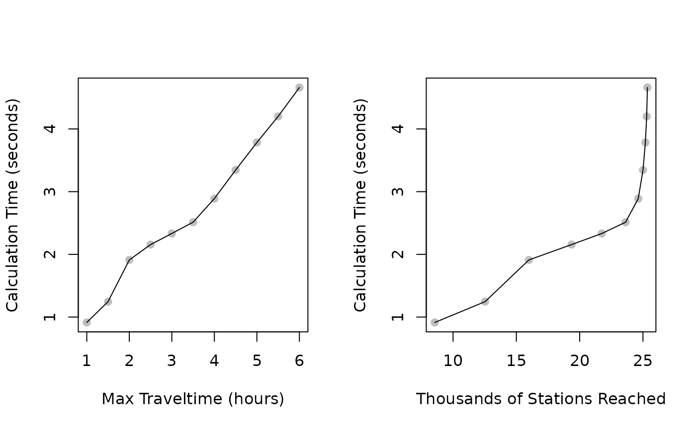

# Travel Times

`gtfsrouter` includes a function,
[`gtfs_traveltimes()`](https://UrbanAnalyst.github.io/gtfsrouter/reference/gtfs_traveltimes.html),
to efficiently calculate travel times from a nominated station to all
other stations within a GTFS feed. The function takes only two main
parameters, the first specifying a departure station, and the second
specifying a pair of `start_time_limits` determining the earliest and
latest possible departure times from that station. The function will
then return the fastest connections to all possible end stations for
services departing within the specified `start_time_limits`.

For example, travel times to all stations for services leaving a
nominated station between 12:00 and 13:00 can be extracted by specifying
`start_time_limits = c (12, 13) * 3600`. The following code uses the
internal Berlin data to demonstrate, starting by reading the GTFS data
and constructing a timetable for a specified day. This second step,
achieved by calling the [`gtfs_timetable()`
function](https://UrbanAnalyst.github.io/gtfsrouter/reference/gtfs_timetable.html),
is necessary prior to calculating travel times.

``` r

library (gtfsrouter)
berlin_gtfs_to_zip ()
```

    ## /tmp/RtmpCpJZRG/vbb.zip

``` r

f <- file.path (tempdir (), "vbb.zip")
gtfs <- extract_gtfs (f, quiet = TRUE)
gtfs <- gtfs_timetable (gtfs, day = 3)
```

The
[`gtfs_traveltimes()`](https://UrbanAnalyst.github.io/gtfsrouter/reference/gtfs_traveltimes.html),
function may then be called by specifying a start station (`from`), and
`start_time_limits`, as in the following code:

``` r

from <- "Alexanderplatz"
start_time_limits <- c (12, 13) * 3600
tt <- gtfs_traveltimes (
    gtfs,
    from = from,
    start_time_limits = start_time_limits
)
head (tt)
```

    ##   start_time duration ntransfers      stop_id               stop_name stop_lon
    ## 1   12:00:42 00:14:42          1 060003102223     S Bellevue (Berlin) 13.34710
    ## 2   12:00:42 00:08:36          0 060003102224     S Bellevue (Berlin) 13.34710
    ## 3   12:00:42 00:15:06          1 060003103233   S Tiergarten (Berlin) 13.33624
    ## 4   12:00:42 00:10:42          0 060003103234   S Tiergarten (Berlin) 13.33624
    ## 5   12:00:42 00:14:18          1 060003201213 S+U Berlin Hauptbahnhof 13.36892
    ## 6   12:00:42 00:05:54          0 060003201214 S+U Berlin Hauptbahnhof 13.36892
    ##   stop_lat
    ## 1 52.51995
    ## 2 52.51995
    ## 3 52.51396
    ## 4 52.51396
    ## 5 52.52585
    ## 6 52.52585

The function returns a `data.frame` in which each row details the
fastest connection to each station, in terms of the start time and
duration of that trip, as well as the number of transfers necessary.

## Maximum Traveltimes

The previous code returns a `data.frame` detailing traveltimes for the
following stations:

``` r

nrow (tt)
```

    ## [1] 689

This relatively low number is because the [`berlin_gtfs_to_zip()`
function](https://UrbanAnalyst.github.io/gtfsrouter/reference/berlin_gtfs_to_zip.html)
creates only a small sample portion of a full feed, extending over only
one hour and containing a small number of stations. The total number of
stations reachable from the Alexanderplatz station during these times
are:

``` r

nrow (gtfs$stops)
```

    ## [1] 957

The
[`gtfs_traveltimes()`](https://UrbanAnalyst.github.io/gtfsrouter/reference/gtfs_traveltimes.html),
returns travel times to only a subset of all potentially reachable
stations (689 instead of 957) for two main reasons. First, not all
stations may actually be reachable from a given station, and travel
times will only be returned for those that are. Secondly, the
[`gtfs_traveltimes()`](https://UrbanAnalyst.github.io/gtfsrouter/reference/gtfs_traveltimes.html),
function has an additional parameter, `max_traveltime`, and only returns
travel times to stations able to be reached within this upper limit. The
default value is 3600, or one hour. For the token feed used here, the
maximum travel times returned are:

``` r

library (hms)
hms (as.integer (max (tt$duration)))
```

    ## Warning in hms(as.integer(max(tt$duration))): NAs introduced by coercion

    ## NA

In this case that value actually reflects the restricted data included
in the sample data set, but applying the function to an actual GTFS feed
will by default record traveltimes to all stations reachable within one
hour. The following shows a more realistic example using a full version
of the Berlin GTFS data:

``` r

gtfs <- extract_gtfs ("/<path>/<to>/vbb.zip")
gtfs <- gtfs_timetable (gtfs, day = 3)
tt <- gtfs_traveltimes (
    gtfs,
    from = from,
    start_time_limits = start_time_limits
)
nrow (tt)
hms::hms (as.integer (max (tt$duration)))
## [1] 8556
## 01:00:00
```

The number of stations reached in the full feed is far more, and the
maximum trip duration is indeed precisely one hour. This parameter of
`max_traveltime` defaults to the relatively short value of one hour
because calculation times increase non-linearly with numbers of stations
reached. The following graphs show calculation times as a function both
of `max_traveltime`, and numbers of stations reached.

Click one the arrow to the left to see code used to generate these
results

``` r

maxt <- 3600 + 0:10 * 1800 # 1-6 hours in half-hour intervals
dat <- vapply (
    maxt, function (i) {
        st <- system.time (
            res <- gtfs_traveltimes (
                gtfs,
                from = from,
                start_time_limits = start_time_limits,
                max_traveltime = i
            )
        )
        return (c (st [3], nrow (res))) },
    numeric (2)
)
dat <- data.frame (
    max_time = maxt / 3600, # in hours
    calc_time = dat [1, ],
    n_stns = dat [2, ] / 1000
)
par (mfrow = c (1, 2))
plot (dat$max_time, dat$calc_time,
    pch = 19, col = "gray",
    xlab = "Max Traveltime (hours)",
    ylab = "Calculation Time (seconds)"
)
lines (dat$max_time, dat$calc_time)
plot (dat$n_stns, dat$calc_time,
    pch = 19, col = "gray",
    xlab = "Thousands of Stations Reached",
    ylab = "Calculation Time (seconds)"
)
lines (dat$n_stns, dat$calc_time)
```

  



Those graphs show that increasing the `max_traveltime` parameter leads
to approximately linear increases in the calculation times required for
[`gtfs_traveltimes()`](https://UrbanAnalyst.github.io/gtfsrouter/reference/gtfs_traveltimes.html),
to execute, while relationships with numbers of stations actually
reached are highly non-linear. The panel on the right side shows that
increases in `max_traveltime` eventually have little effect on
increasing numbers of stations reached, yet increases computation times
considerably. Values for `max_traveltime` should accordingly only be
adjusted after first determining appropriate values. In particular, note
that although the Berlin GTFS has a large number of distinct stops:

``` r

nrow (gtfs$stops)
## [1] 41577
```

Many of these reflect `stop_id` values for multiple platforms at a
single station. The number of distinct stop names is in fact much less:

``` r

length (unique (gtfs$stops$stop_name))
## [1] 13090
```

A rule-of-thumb is to increase the `max_traveltime` parameter until the
number of stations reached exceeds by some small amount the total number
of actual stops in a system. In the case of these Berlin data, a maximum
traveltime of 2 hours is sufficient.

``` r

nrow (gtfs_traveltimes (
    gtfs,
    from = from,
    start_time_limits = start_time_limits,
    max_traveltime = 7200
))
## [1] 15989
```

These additional stations reached naturally tend to be stations on the
periphery of the system, while doubling the `max_traveltime` parameter
approximately doubles the calculation time (in this case, according to
the graphs shown above). Appropriate values will depend on the nature of
desired results. Analyses focussed on more central parts of a system can
use smaller values, with shorter corresponding calculation times.
Analyses for which peripheral stations are important may need to use
larger values of `max_traveltimes`, yet should do so carefully to avoid
undue increases in calculation times.

## Fastest Routes versus Minimal-Transfer Routes

The
[`gtfs_traveltimes()`](https://UrbanAnalyst.github.io/gtfsrouter/reference/gtfs_traveltimes.html),
function has an additional parameter, `minimise_transfers`, which can be
used to return either the fastest possible connections from a start
station to all other reachable stations within a system, or the fastest
connection which has the least possible number of transfers. Connections
with the least transfers may be slower than fastest possible
connections, as shown by the following analysis.

``` r

tt_fastest <- gtfs_traveltimes (
    gtfs,
    from = from,
    start_time_limits = start_time_limits
)
tt_min_tr <- gtfs_traveltimes (
    gtfs,
    from = from,
    start_time_limits = start_time_limits,
    minimise_transfers = TRUE
)
# non-dplyr join:
tt_fastest <- tt_fastest [tt_fastest$stop_id %in% tt_min_tr$stop_id, ]
tt_min_tr <- tt_min_tr [tt_min_tr$stop_id %in% tt_fastest$stop_id, ]
dat <- data.frame (
    stop_id = tt_fastest$stop_id,
    fastest_dur = as.numeric (tt_fastest$duration / 3600), # hours
    fastest_ntr = tt_fastest$ntransfers,
    min_tr_dur = as.numeric (tt_min_tr$duration / 3600),
    min_tr_ntr = tt_min_tr$ntransfers
)

60 * mean (dat$min_tr_dur - dat$fastest_dur) # in minutes
## [1] 3.957052
```

``` r

mean (dat$fastest_ntr - dat$min_tr_ntr)
## [1] 0.2818428
```

Minimal-transfer trips take on average just under 4 minutes longer,
while requiring 0.28 fewer trips. Most fastest trips are nevertheless
also minimal-transfer trips, as can be seen by the number of identical
values returned by these two queries.

``` r

length (which (dat$min_tr_ntr == dat$fastest_ntr)) / nrow (dat)
## [1] 0.6875221
```

So almost 70% of faster trips are also trips with fewest number of
transfers, with around 30% of fastest trips involving more than the
minimal possible number of transfers.

## The Traveltimes Algorithm

The
[`gtfs_traveltimes()`](https://UrbanAnalyst.github.io/gtfsrouter/reference/gtfs_traveltimes.html),
is based on a new algorithm specifically developed for this package, and
which will be described here in further detail in subsequent releases of
the package.
